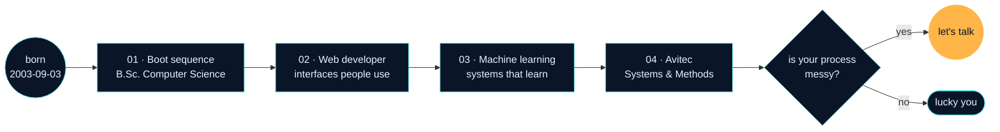
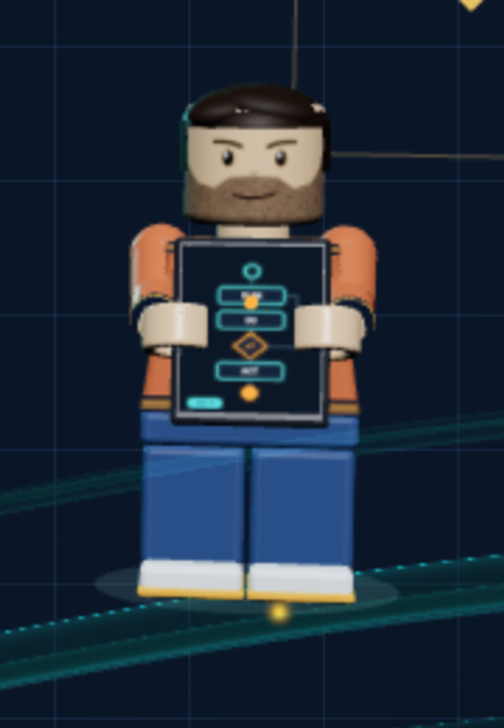

  

My work is turning tangled processes into clean ones, so this README is written as one too: a process model of me.

| | |
| --- | --- |
| **Process** | `mahdi_rasouli.exe` |
| **Owner** | Mahdi Rasouli |
| **Started** | 3 September 2003 |
| **Current step** | AI process engineer, Systems & Methods at Avitec |
| **Input** | a messy process |
| **Output** | an elegant system |
| **This repository** | my portfolio and résumé as one interactive 3D page |

## ○ Start event

On the site, my career starts as a tangled knot of pipes. When you press **Optimize me**, it pulls straight into one clean flow, and a LEGO version of me walks it from node to node. That's what I do for a living, compressed into a single scroll.

## ▭ Process map

## ▭ Step log

| Step | Input | Activity | Output |
| --- | --- | --- | --- |
| **01 · Boot sequence** | curiosity | B.Sc. in Computer Science: algorithms, data structures, software design | the habit of seeing every problem as inputs, steps and outputs |
| **02 · Web developer** | a design and a deadline | production websites and web apps with TypeScript, React and Next.js | interfaces people actually use |
| **03 · Machine learning** | raw data | a machine-learning course and end-to-end models: cleaning, features, training, evaluation | systems that learn from data |
| **04 · Avitec** | how a company really works | map and model processes, find the bottlenecks, automate steps with AI | processes that are faster, leaner and smarter |

## ▭ Bill of materials: the minifigure

<table>
  <tr>
    <td width="42%"></td>
    <td>
      <b>Set 0309 · Mahdi</b> 
      (named after 03/09, my birthday)
        
      1 × head, printed: heavy brows, stubble beard, calm half-smile 
      1 × hair piece: dark brown quiff, parted to one side 
      1 × torso: open coral bomber jacket over a cream tee with a process-flow print 
      2 × arms: coral sleeves, navy-and-amber striped cuffs 
      2 × hands, C-clip 
      1 × hips and legs: denim 
      2 × white sneakers with amber soles
        
      <b>Swapped in for each chapter</b> 
      graduation cap · laptop · glowing brain · tablet running a process diagram
        
      No 3D model file anywhere: every brick, print and prop is generated in code from real minifig proportions, so he costs the page almost nothing to load.
    </td>
  </tr>
</table>

## ◇ Acceptance tests

Things to try on the site. Tick them off as you go.

- [ ] Press **Optimize me** and watch the knot untangle (and my name stretch)
- [ ] Watch LEGO me pop onto the flow and walk to each node
- [ ] Move your cursor; he turns his head to follow it
- [ ] Spot the prop he carries in every chapter
- [ ] **Untangle the pipeline**: turn the pipes until the flow runs from input to output, three boards, fewer taps for more stars
- [ ] Reach the last node and get waved at
- [ ] Turn on "reduce motion" on your device: everything holds still and you still get the whole story
- [ ] Open it without WebGL: the same story as a flat diagram

## ▭ Process metrics

| Metric | Value |
| --- | --- |
| Servers behind the site | 0 |
| 3D model files downloaded | 0 |
| Frames rendered while the tab is hidden | 0 |
| When the frame rate drops | resolution steps down, the animation keeps going |
| Built with | Next.js · React · TypeScript · three.js / React Three Fiber · GSAP · Motion |

## ◉ End event

Every process needs an end event. Mine is a conversation: the last node on the site has my links and my résumé.

<b>Got a messy process? Let's talk.</b>

